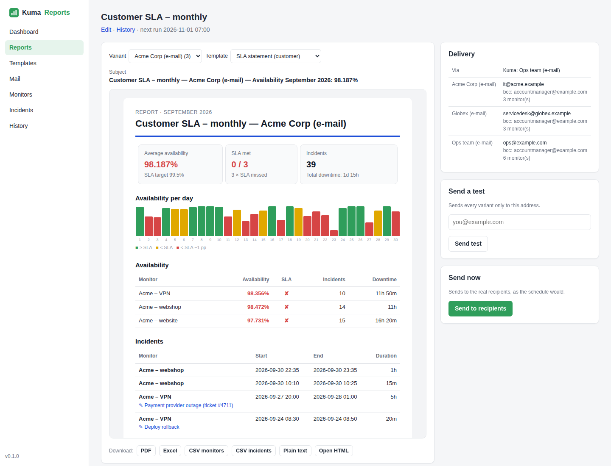
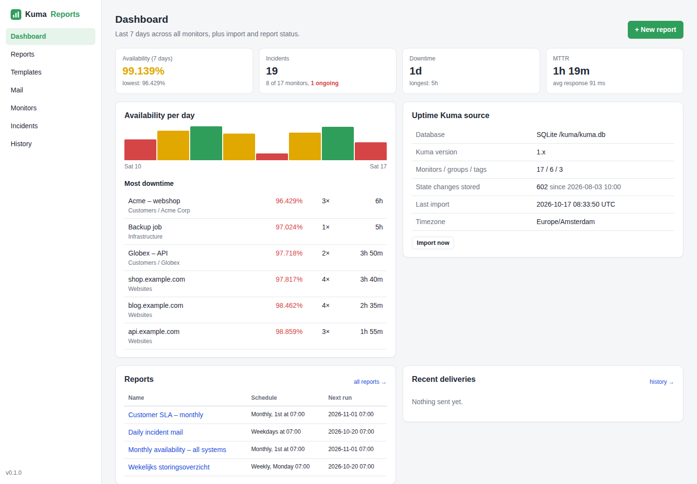
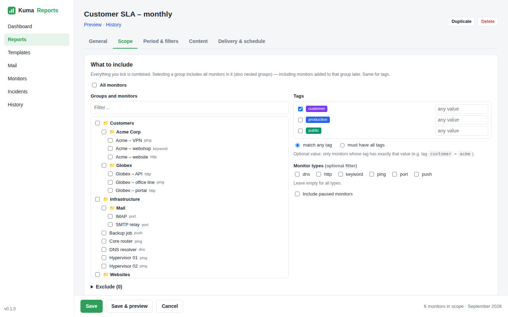
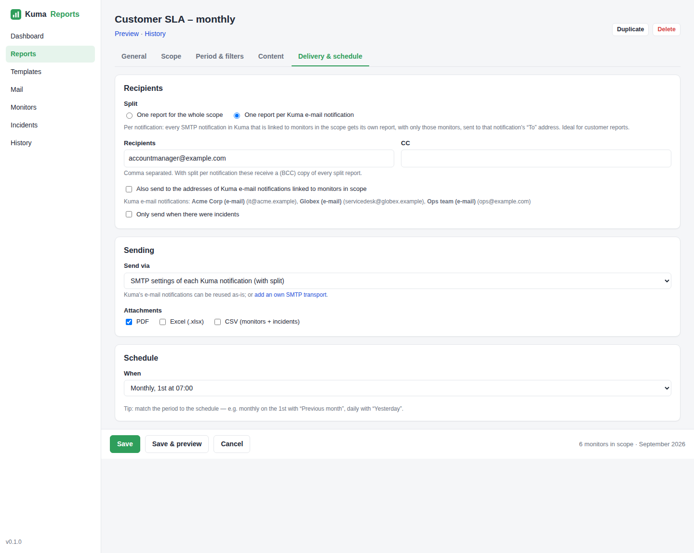
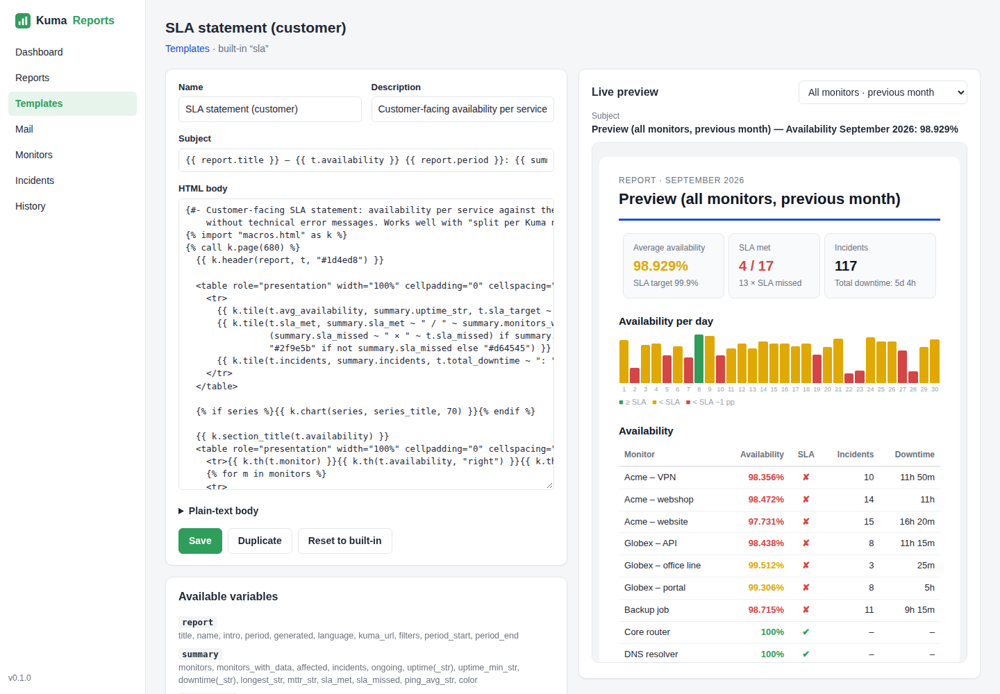
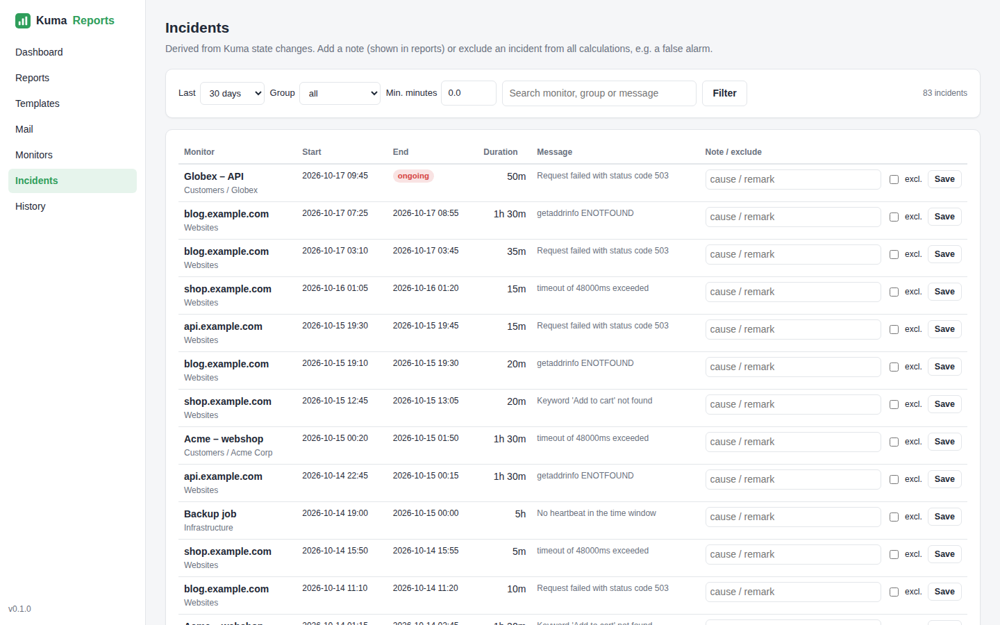
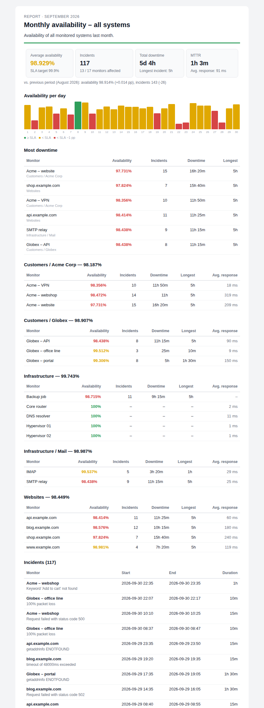

<p align="center">
  
</p>
<h1 align="center">Kuma Reports</h1>
<p align="center">
  <b>Scheduled availability, SLA and incident reports for <a href="https://github.com/louislam/uptime-kuma">Uptime Kuma</a></b><br>
  A small sidecar container with a web GUI — reads Kuma read-only, mails reports on a schedule.
</p>

<p align="center">
  
</p>

---

Uptime Kuma tells you *right now* what is down. Kuma Reports tells you — and your customers or manager —
**how it went last week, month or quarter**: availability per service, SLA met or missed, every incident
with its duration and cause, trends against the previous period. Delivered by e-mail as a polished HTML
report, with PDF, Excel and CSV attachments.

## Features

- **Zero double configuration** — monitors, groups, tags, e-mail notifications and heartbeats are read
  directly from Kuma's database. Works with **SQLite**, **embedded MariaDB** and **external MariaDB/MySQL**,
  Kuma **1.23+ and 2.x**. Kuma is never written to.
- **Scope reports the way you organise Kuma** — monitors, whole groups (nested; new monitors are picked up
  automatically), tags with optional values (`customer = acme`), monitor types, exclusions.
- **Send through what Kuma already has** — reuse Kuma's e-mail notifications (SMTP server, sender,
  recipients) or add your own SMTP transports.
- **One report definition, a report per customer** — *split per Kuma notification*: every e-mail
  notification linked to monitors in scope gets its own report containing only its monitors.
- **Real SLA numbers** — time-based availability from state changes, SLA target, MTTR, MTBF, longest
  incident, comparison with the previous period, business-hours-only calculation, flap filter, maintenance
  excluded or counted.
- **Templates** — four built-in layouts (standard, compact, customer SLA statement, operations incident
  overview), editable Jinja2 with reusable building blocks and a live preview. Report language EN / NL / DE.
- **Attachments** — PDF, Excel (.xlsx) and CSV; everything can also be previewed and downloaded in the GUI.
- **Incident notes** — add a cause or ticket number to an incident, or exclude a false alarm from all reports.
- **Keeps its own history** — state changes are copied every few minutes, so yearly reports keep working
  after Kuma prunes old heartbeats.
- **Schedules** — daily, weekdays, weekly, monthly, quarterly, yearly or any cron expression; optionally
  only send when there were incidents. Every delivery is archived.

## Screenshots

| Dashboard | Report scope |
|---|---|
| [](docs/screenshots/dashboard.png) | [](docs/screenshots/report-scope.png) |
| **Delivery & split per customer** | **Template editor with live preview** |
| [](docs/screenshots/report-delivery.png) | [](docs/screenshots/template-editor.png) |
| **Incidents with notes** | **Standard report e-mail** |
| [](docs/screenshots/incidents.png) | [](docs/screenshots/mail-standard.png) |

*(Screenshots use generated demo data — see [Try it with demo data](#try-it-with-demo-data).)*

---

## Installation

### Option 1 — installer (recommended)

On the Docker host where Uptime Kuma runs:

```sh
curl -fsSL https://raw.githubusercontent.com/evdbovenkamp/kuma-reports/main/install.sh -o install.sh
less install.sh        # always read a script before running it as root
sudo bash install.sh
```

The installer:

1. finds your running Uptime Kuma container and its data volume (or bind mount);
2. reads Kuma's `db-config.json` to see which database it uses;
3. sets up **read-only** database access (see the table below);
4. asks for timezone, Kuma's public URL, and the address/port for the GUI;
5. writes `/opt/kuma-reports/docker-compose.yml` and `.env` (with a generated admin password);
6. starts the container and prints the URL and login.

| Kuma database | What the installer does |
|---|---|
| **SQLite** (Kuma 1.x, default for 2.x) | Nothing extra: the database file is opened read-only from the data volume. |
| **Embedded MariaDB** (inside the Kuma container) | Creates a user `reporter` with only `SELECT` on Kuma's database, through Kuma's MariaDB socket. |
| **MariaDB/MySQL in another container** on the same host | Finds that container via the hostname in `db-config.json`, creates the `reporter` user there (root password from `MARIADB_ROOT_PASSWORD`/`MYSQL_ROOT_PASSWORD`, or asked), and joins Kuma's Docker network. |
| **External MariaDB/MySQL server** | Shows the `CREATE USER`/`GRANT` statements to run and asks for the password; joins Kuma's Docker network. |

Options: `--container NAME`, `--dir PATH`, `--bind ADDRESS`, `--port PORT`, `--build` (build from source),
`--yes` (no questions, use defaults). Run `bash install.sh --help` for all of them.

**Upgrading:** run the installer again — it detects the existing installation and upgrades it.

### Option 2 — Docker Compose by hand

1. **Find Kuma's data volume and database type**

   ```sh
   docker inspect uptime-kuma --format '{{range .Mounts}}{{.Type}} {{.Name}}{{.Source}} -> {{.Destination}}{{"\n"}}{{end}}'
   docker exec uptime-kuma cat /app/data/db-config.json   # no file = SQLite
   ```

2. **Create a read-only database user** (MariaDB only — skip for SQLite)

   Embedded MariaDB (`"type": "embedded-mariadb"`):

   ```sh
   docker exec -i uptime-kuma mariadb -S /app/data/run/mariadb.sock -u root <<'SQL'
   CREATE USER 'reporter'@'localhost' IDENTIFIED BY 'choose-a-long-password';
   GRANT SELECT ON kuma.* TO 'reporter'@'localhost';
   SQL
   ```

   MariaDB/MySQL in its own container or on a server (`"type": "mariadb"`):

   ```sql
   CREATE USER 'reporter'@'%' IDENTIFIED BY 'choose-a-long-password';
   GRANT SELECT ON kuma.* TO 'reporter'@'%';
   ```

3. **Create `docker-compose.yml` and `.env`**

   ```sh
   mkdir -p /opt/kuma-reports && cd /opt/kuma-reports
   curl -fsSLO https://raw.githubusercontent.com/evdbovenkamp/kuma-reports/main/docker-compose.yml
   curl -fsSL https://raw.githubusercontent.com/evdbovenkamp/kuma-reports/main/.env.example -o .env
   chmod 600 .env
   ```

   - In `docker-compose.yml`, set the name of Kuma's data volume (or replace it with the host path of Kuma's
     data directory). For a database in another container, uncomment `networks` and use Kuma's network.
   - In `.env`, set `KUMA_DB_PASSWORD` (MariaDB), `TZ`, `KUMA_BASE_URL` and optionally `ADMIN_PASSWORD`.

4. **Start**

   ```sh
   docker compose up -d
   docker compose logs -f     # look for "Import done"
   ```

   Open `http://127.0.0.1:8080`. Without `ADMIN_PASSWORD` you choose a password on the first visit.

### Reaching the GUI

By default the GUI only listens on `127.0.0.1:8080`. Use a reverse proxy with TLS, a VPN address
(`--bind 100.x.y.z` for Tailscale), or an SSH tunnel: `ssh -L 8080:127.0.0.1:8080 you@server`.

<details>
<summary>nginx example</summary>

```nginx
server {
    listen 443 ssl;
    server_name reports.example.com;
    # ssl_certificate ...;

    location / {
        proxy_pass http://127.0.0.1:8080;
        proxy_set_header Host $host;
        proxy_set_header X-Forwarded-For $proxy_add_x_forwarded_for;
        proxy_set_header X-Forwarded-Proto $scheme;
    }
}
```

Set `BASE_URL=https://reports.example.com` in `.env` so session cookies are marked secure.
</details>

<details>
<summary>Caddy example</summary>

```caddyfile
reports.example.com {
    reverse_proxy 127.0.0.1:8080
}
```
</details>

---

## Getting started

1. **Mail** — check that your Kuma e-mail notifications are listed, and send a test mail.
2. **Reports → New report**
   - *Scope*: tick groups, monitors or tags. The bar at the bottom shows how many monitors are included.
   - *Period & filters*: e.g. *Previous month*, SLA target 99.9 %, ignore incidents shorter than 2 minutes.
   - *Delivery & schedule*: recipients, *split per Kuma notification* for customer reports, attachments,
     and a schedule (e.g. *Monthly, 1st at 07:00*).
3. **Save & preview** — check the result, download the PDF, and use *Send test* to mail it to yourself.

Some useful combinations:

| Report | Scope | Period | Template | Delivery |
|---|---|---|---|---|
| Monthly SLA per customer | tag `customer` | Previous month | SLA statement | Split per Kuma notification, PDF |
| Daily incident mail | All monitors | Yesterday | Compact | Weekdays 07:00, only if incidents |
| Weekly operations | All monitors, grouped by group | Previous week | Incident overview | Monday 07:00, CSV |
| Quarterly management report | Production groups | Previous quarter | Standard | Quarterly, PDF + Excel |

## Configuration

All settings are environment variables in `.env` — see [`.env.example`](.env.example). Any variable can also
be read from a file by adding `_FILE` (Docker secrets), e.g. `KUMA_DB_PASSWORD_FILE`.

| Variable | Default | Description |
|---|---|---|
| `KUMA_DB_TYPE` | `auto` | `auto`, `sqlite`, `embedded-mariadb` or `mariadb`. `auto` reads `/kuma/db-config.json`. |
| `KUMA_DB_USER` / `KUMA_DB_PASSWORD` | `reporter` / – | Read-only MariaDB user. |
| `KUMA_DB_HOST` / `KUMA_DB_PORT` / `KUMA_DB_NAME` | from `db-config.json` | Override the external database location. |
| `KUMA_DB_PATH` / `KUMA_DB_SOCKET` | `/kuma/kuma.db` / `/kuma/run/mariadb.sock` | SQLite file / embedded MariaDB socket. |
| `KUMA_DB_URL` | – | Full SQLAlchemy URL; overrides everything above. |
| `KUMA_BASE_URL` | – | Public URL of Uptime Kuma, for "view in Kuma" links. |
| `TZ` | `UTC` | Timezone for report periods, schedules and dates. |
| `AUTH_MODE` | `form` | `form` (built-in login) or `none` (only behind an authenticating proxy!). |
| `ADMIN_USERNAME` / `ADMIN_PASSWORD` | `admin` / – | Without a password you set one on first visit. |
| `BASE_URL` | – | Public URL of Kuma Reports; `https://…` enables secure cookies. |
| `IMPORT_INTERVAL` | `300` | Seconds between imports from Kuma. |
| `HISTORY_KEEP_DAYS` | `400` | How long archived report mails are kept. |
| `PUID` / `PGID` | `1000` | User the app runs as inside the container. |

## How the numbers are calculated

- **Incident**: from a state change to *down* until the next change to *up* (or maintenance). Kuma marks
  these transitions as "important" heartbeats; exactly those are imported.
- **Availability** = 1 − downtime ÷ monitored time in the period. Monitored time starts at the monitor's
  creation when that is inside the period. Maintenance is left out of both, unless *count maintenance as
  downtime* is enabled. With business hours enabled only time within those hours counts.
- **Summary availability** is time-weighted over all monitors in scope.
- **MTTR** = average duration of resolved incidents; **MTBF** = up-time ÷ number of incidents.
- **Check counts and response times** come from Kuma's daily statistics (`stat_daily` in 2.x, aggregated
  heartbeats in 1.x).
- **History before installation**: Kuma 2.x keeps a limited number of raw heartbeats per monitor. When no
  state change is known before a period, the monitor is assumed to have been up. From installation on,
  every transition is recorded in Kuma Reports' own database.

## Templates

Templates are sandboxed Jinja2 with a subject, an HTML body and an optional plain-text body. The built-in
templates are composed from building blocks in `macros.html`, which you can use too:

```jinja


  {{ k.header(report, t) }}
  {{ k.tiles(summary, t, sla_target_str, previous) }}
  {{ k.chart(series, series_title) }}
  {{ k.monitor_table(monitors, t) }}
  {{ k.incident_table(incidents, t) }}
  {{ k.footer(report, t) }}

```

The editor lists all variables (`report`, `summary`, `monitors`, `incidents`, `series`, `groups`, `previous`,
`t` for translated labels, …) and previews your changes live against any report. Built-in templates can be
edited and reset; *Duplicate* gives you your own copy.

## Monitoring Kuma Reports with Uptime Kuma

`/healthz` (no login needed) checks whether Kuma Reports can actually do its job:

```json
{"status": "ok", "version": "0.1.1", "checks": {
  "kuma_db":    {"ok": true},
  "import":     {"ok": true, "last_import_age_s": 120, "error": null},
  "scheduler":  {"ok": true},
  "deliveries": {"ok": true, "failed_24h": 0, "sent_24h": 3}}}
```

| Status | HTTP | Meaning |
|---|---|---|
| `ok` | 200 | All good. |
| `degraded` | 200 | A report delivery failed in the last 24 hours (test sends excluded). |
| `fail` | 503 | Kuma's database is unreachable, the last import is older than 3 × `IMPORT_INTERVAL`, or the scheduler stopped. |

The installer puts Kuma Reports on Kuma's Docker network(s), so Kuma can reach it by container name.
Add two monitors in Uptime Kuma:

| Monitor | Type | URL | Check | Interval |
|---|---|---|---|---|
| Kuma Reports | HTTP(s) | `http://kuma-reports:8080/healthz` | status code 200–299 (503 = down) | 60 s, 3 retries |
| Kuma Reports – deliveries | HTTP(s) – Json Query | `http://kuma-reports:8080/healthz` | `checks.deliveries.ok` equals `true` | 300 s |

The Docker `HEALTHCHECK` uses the same endpoint, so `docker ps` shows `unhealthy` in the `fail` state too.
(A Docker-container monitor is not recommended: it would require mounting the Docker socket into Kuma, and it
only tells you the container runs, not that reports work.)

## Operations

| Task | How |
|---|---|
| Logs | `docker compose -f /opt/kuma-reports/docker-compose.yml logs -f` |
| Upgrade | Run the installer again, or `docker compose pull && docker compose up -d` |
| Backup | Copy `/opt/kuma-reports/data/` (reports, templates, notes, history) and `.env` |
| Uninstall | `docker compose down`, remove `/opt/kuma-reports`, and `DROP USER 'reporter'@…` in MariaDB |

## Security

- Read-only all the way: a `SELECT`-only database user, and Kuma's data volume mounted `:ro`.
- Kuma's notification settings (including SMTP passwords) are read at send time and never stored.
- Own SMTP passwords are stored in Kuma Reports' database under `/data` — protect that volume and `.env`.
- Built-in login with scrypt-hashed password (or `ADMIN_PASSWORD`), CSRF protection on every form,
  sandboxed templates. Don't expose the GUI to the internet without TLS.

## Troubleshooting

| Symptom | Fix |
|---|---|
| Dashboard shows an import error `Access denied for user 'reporter'` | Password in `.env` doesn't match, or the user was created for the wrong host (`localhost` for embedded, `%` for external). |
| `Can't connect to local server through socket` | Kuma's data volume isn't mounted at `/kuma`, or Kuma isn't running. |
| `unable to open database file` (SQLite) | Wrong volume or path; check `KUMA_DB_PATH`. |
| External MariaDB: `Unknown MySQL server host` | Kuma Reports isn't on the same Docker network as the database. |
| Test mail fails with a TLS error | Use the right port/security combination (465 = SSL, 587 = STARTTLS) or disable verification for internal relays. |
| Old periods show monitors as 100 % up | Expected for history from before installation on Kuma 2.x (see *How the numbers are calculated*). |

## Try it with demo data

No Kuma at hand? Generate a realistic fake Kuma database (17 monitors, groups, tags, customer
notifications, 75 days of heartbeats) and run against it:

```sh
python3 scripts/demo_kuma_db.py demo/kuma.db
docker build -t kuma-reports .
docker run --rm -p 8080:8080 -e AUTH_MODE=none -e TZ=Europe/Amsterdam \
  -v "$PWD/demo:/kuma:ro" kuma-reports
```

## Development

```sh
python3 -m venv .venv && .venv/bin/pip install -r requirements.txt
python3 scripts/demo_kuma_db.py demo/kuma.db
DATA_DIR=./data KUMA_DB_TYPE=sqlite KUMA_DB_PATH=demo/kuma.db AUTH_MODE=none \
  .venv/bin/uvicorn app.main:app --reload --port 8080
```

Stack: FastAPI, SQLAlchemy, APScheduler, Jinja2, WeasyPrint (PDF, needs Pango — included in the image),
openpyxl. No JavaScript build step. Issues and pull requests are welcome.

## License

[MIT](LICENSE). Not affiliated with the Uptime Kuma project.
